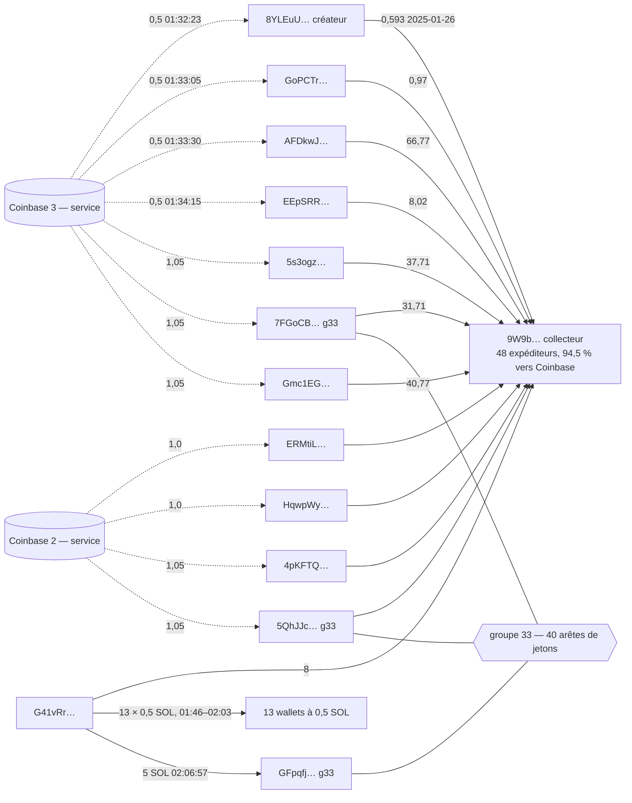

# FINANCIAL_BENEFICIARIES — qui a gagné, et par où l'argent est sorti

## Comptabilité

Méthode du dépôt (`reports/TOP_TRADERS.md`, `data/exit_summary.json`), reprise sans modification :
- **Réalisé** = SOL reçus des ventes − coût moyen des jetons vendus. Tous lieux : Raydium v4, CLMM, Meteora DLMM, Orca, courbe pump.fun.
- **Flux net** = SOL vendus − SOL achetés.
- **Non réalisé** = jetons résiduels (M) valorisés à zéro faute de prix de sortie. Pour les wallets ci-dessous, le résiduel est ≈ 0, donc le non réalisé est négligeable sauf indication.

Cet addendum **ne recalcule pas** le PnL de vie. Il le recoupe :
- même liste de 17 acheteurs dans les 60 s ;
- même total de 11,916 SOL que `group_split.json:premieres_60s` ;
- même ordre d'arrivée sur les 25 premiers.

Dataset : `data/beneficiaries_top30.csv`.

## 1. Classement par profit réalisé (top 15)

| # | Wallet | Réalisé SOL | Flux net | Entrée (dépôt) | Cohorte | Financement observé | Sorties principales (dépôt) | Lien avec un promoteur |
|---|---|---|---|---|---|---|---|---|
| 1 | `H3QsBr…` | **5 490,9** | 5 490,9 | 14/07 16:43:58 | avant le visuel | Coinbase 1, 0,834 (2024-03) | service non nommé 11 637,6 ; `8YSi5y…` 2 840 | **non établi** (mention tierce C) |
| 2 | `GXZvXs…` | **2 540,1** | 2 540,1 | 14/07 02:15:41 | avant le visuel | non résolu | `Co3zTr…` 1 530,3 ; `8N4AvP…` 499,1 | **non établi** (mention tierce C) |
| 3 | `FTKTNF…` | 2 046,0 | 2 046,0 | 21/07 19:47:57 | après Musk | non examiné | Jupiter 3 579 ; pool 2 105 | non établi |
| 4 | `9PrmF8…` | **1 747,8** | 1 747,4 | 14/07 02:28:56 | avant le visuel | Coinbase 3, 5,56 (2024-01) | Coinbase 3 795,6 ; Coinbase 1 621,9 ; Coinbase 2 279,7 | non établi |
| 5 | `F1DRDB…` | 1 709,5 | 1 709,5 | 15/07 16:54:33 | avant le visuel | non examiné | `DV2eie…` 2 472,1 | non établi |
| 6 | `6Lomz4…` | 1 466,6 | 1 382,2 | 14/07 02:07:06 | avant le visuel | Binance 2 | `Ddgp…` 715,6 | non établi |
| 7 | `CEzjbQ…` | 1 323,0 | 1 322,0 | 14/07 02:06:58 | avant le visuel | `DQ5JWb…` 2,853 (00:01:26) | `HpXPpV…` 209 | non établi |
| 8 | `DKs3wS…` | 1 179,8 | 806,8 | 22/07 | après Musk | — | — | non établi |
| 9 | `Go3fTC…` | 765,3 | 765,3 | 21/07 | après Musk | — | — | non établi |
| 10 | `FHXYk1…` | 762,0 | 762,0 | 21/07 | après Musk | — | — | non établi |
| 11 | `9cfRU5…` | 729,2 | 729,2 | 14/07 12:59:49 | Choupette hors groupe | `7Gw3gL…` 4 SOL (02:18) | **1 471,1 renvoyés à `7Gw3gL…`** (aller-retour avec son financeur) | non établi |
| 12 | `F2kcbX…` | 705,8 | 722,9 | 14/07 02:34:43 | avant le visuel | — | — | non établi |
| 13 | `7Fa8XG…` | 646,2 | 646,2 | 21/07 22:08:04 | après Musk | non examiné | service non nommé 11 779 ; pool 10 990,7 ; Bybit 2 8 523,4 | non établi |
| 14 | `EEdq9C…` | 618,8 | 617,8 | 14/07 06:48:34 | Choupette hors groupe | `2qyz7C…` | `6nMpK4…` 607,7 | non établi |

## 2. Agrégats par ensemble

| Ensemble | Réalisé SOL | Source | Niveau |
|---|---|---|---|
| Groupe 33 (40 arêtes de jetons) | **5 594** (flux net 5 437) | dépôt, `COORDINATION.md` | B (lien entre wallets) |
| Cluster Coinbase/9W9b (11 wallets, dont le créateur) | **268,0** ; 187,1 SOL renvoyés à 9W9b | VI (NOUVEAU) + PnL du dépôt | B |
| Dont `AFDkwJ…` | 79,0 ; 66,77 SOL vers 9W9b | idem | A (flux) |
| Dont `5QhJJc…` (aussi dans le groupe 33) | 74,2 | idem | A (flux) |
| Créateur `8YLEuU…` | 0 réalisé sur DMAGA (28 SOL achetés sur la vie) | dépôt | A |
| G41v | 30,3 ; 8 SOL vers 9W9b | dépôt | A |

**Lecture :**
- Les **plus gros bénéficiaires** (H3Qs, GXZvX, 9PrmF8, FTKTNF, F1DRDB, 6Lomz, CEzjb) n'ont **aucun lien démontré** avec le créateur, DMC, le groupe 33 ou le cluster CB/9W9b.
- Le profit identifiable autour du créateur reste modeste : 268 SOL pour le cluster. Le groupe 33 pèse davantage (5 594 SOL), mais son lien au créateur ne passe que par 2 membres communs au cluster, niveau B.

## 3. Graphe financier (séparé du graphe organisationnel)

Les arêtes en trait plein sont des transferts directs reproductibles (A). Les arêtes en pointillés sont des sources partagées (CEX), **qui ne sont pas des liens de propriété**.

