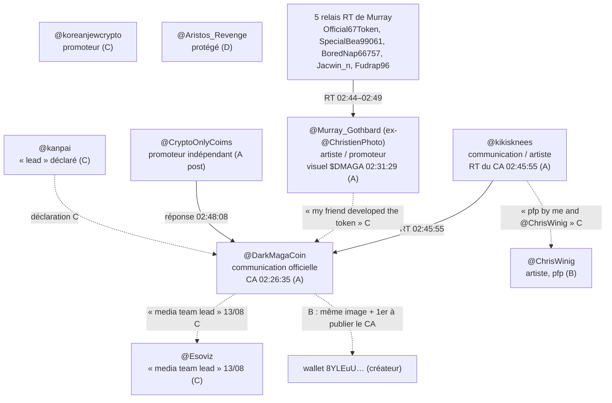

# GRAPHS — graphe organisationnel (séparé du graphe financier)

Le graphe financier se trouve dans `FINANCIAL_BENEFICIARIES.md` § 3. Les deux graphes ne sont reliés que par **une seule** arête, en pointillés : DMC ↔ wallet créateur, niveau B (image commune et publication du CA). Ce n'est pas une preuve de contrôle.

## Classements (rappel)

1. **Promoteurs, par heure de publication** : `EARLIEST_PROMOTERS.md`. Ordre : DMC 02:26:35 → Murray 02:31:29 → adamjia7 02:33:53 → Official67Token 02:44:08 → SpecialBea99061 02:45:49 → kikisknees 02:45:55 → BoredNap66757 02:46:00 → Jacwin_n 02:46:16 → eseleo 02:46:33 → CryptoOnlyCoims 02:48:08.
2. **Acheteurs, par premier achat réussi** : `FIRST_BUYERS.md` § 3 (20 premiers + créateur).
3. **Bénéficiaires, par profit réalisé** : `FINANCIAL_BENEFICIARIES.md` § 1.
